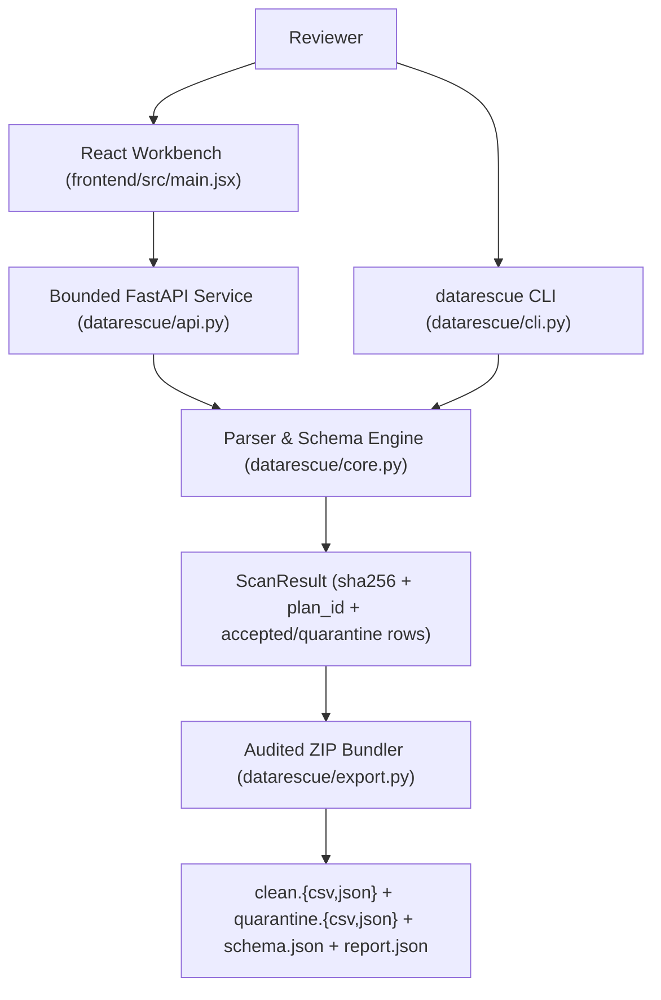
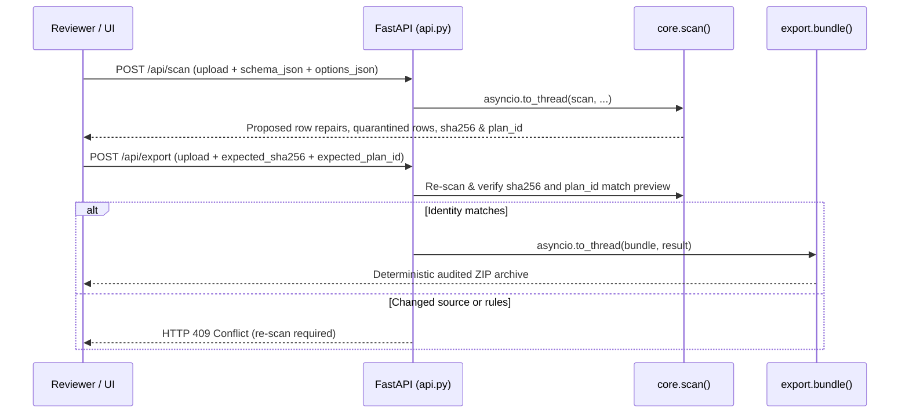

# Architecture: datarescue

Reviewed on 2026-11-07 against the local working tree (`C:/Users/ardhy/Projects/datarescue`). `graphify-out/graph.json` provides the local AST symbol graph.

## 1. System Context & Data Flow

Conservative schema-driven tabular data repair workbench (FastAPI + React + CLI) for bounded CSV, TSV, and JSON files (<= 2 MiB, <= 10,000 rows, <= 100 columns) with quarantine separation, SHA-256 + `plan_id` preview verification, CSV formula-injection escaping, and audited ZIP export.



## 2. Execution & Pipeline Sequence



## 3. Module Breakdown

| Path | Responsibility |
| :--- | :--- |
| `datarescue/core.py` | Bounded CSV/TSV/JSON parser (preserving lexical JSON `Decimal` precision), strict Pydantic `Schema`/`Options`, locale number/date/boolean converters, composite-key uniqueness, and `ScanResult` builder. |
| `datarescue/export.py` | In-memory ZIP bundler emitting clean and raw-original quarantined JSON/CSV tables, spreadsheet formula escaping (`=`, `+`, `-`, `@`), and `report.json`. |
| `datarescue/api.py` | Streaming request-body size limiter, `no-store` privacy headers, threadpool-offloaded `/api/scan` and `/api/export` routes, and bundled example endpoints. |
| `datarescue/cli.py` | CLI scanner and `--approve-repairs` exclusive (`xb`) ZIP exporter verifying input file hash stability. |
| `frontend/src/main.jsx` | Paginated React workbench with dirty-preview guard, schema/locale controls, and diff/quarantine inspection. |
| `tests/` | 4 pytest modules (`test_core.py`, `test_api_cli.py`, `test_export_pipeline.py`, `test_comprehensive.py`). |

## 4. State Management & Failure Handling

Stateless backend with zero persistent upload storage. Original row dictionaries are never mutated in place, composite uniqueness keys are reserved only by accepted rows, and export requires cryptographic agreement on both `sha256` (raw input bytes) and `plan_id` (source + schema + options).

## 5. Verification Commands

```powershell
Set-Location 'C:\Users\ardhy\Projects\datarescue'
& '.\.venv\Scripts\python.exe' -m pytest -q
```

## 6. Integration Boundaries

Localhost-oriented deterministic tabular validator; performs no heuristic fuzzy date guessing, LLM inference, or external network calls.
