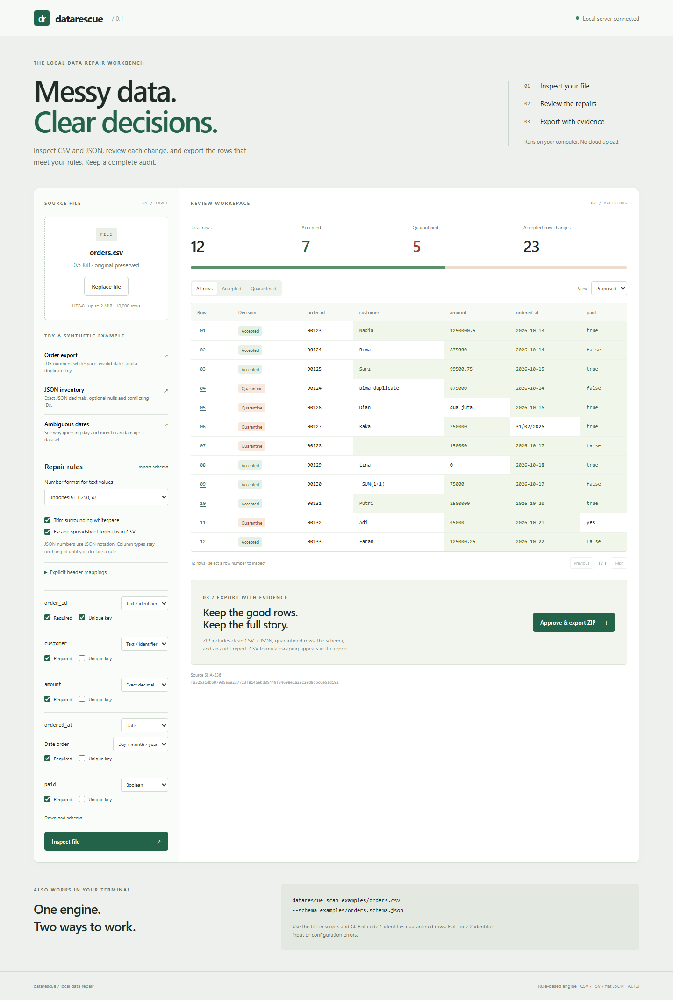

# DataRescue

Inspect messy CSV and JSON, preview each repair, and export clean data with an audit.

[](https://github.com/vanovri/datarescue/actions/workflows/checks.yml)

DataRescue is a local workbench and CLI for small flat datasets. It preserves identifiers, normalizes explicitly configured values, detects schema drift, and quarantines records that do not meet your rules. The original file is never overwritten.



## Try it on Windows

Requirements: Python 3.11+ and Node.js 22.12+ or 24+. The first run downloads Python and npm dependencies. Processing runs locally after setup.

```powershell
git clone https://github.com/vanovri/datarescue.git
cd datarescue
powershell -ExecutionPolicy Bypass -File .\run.ps1
```

You can also unpack the source ZIP and run `run.ps1` inside its DataRescue folder.

Open `http://127.0.0.1:8763`. Choose **Order export**, click **Inspect file**, select a row number to inspect the evidence, and click **Approve & export ZIP**.

## macOS / Linux

```bash
python3 -m venv .venv
source .venv/bin/activate
pip install -c constraints.txt -e '.[dev]'
cd frontend
npm ci
npm run build
cd ..
python -m uvicorn datarescue.api:app --host 127.0.0.1 --port 8763
```

## What it does

- Reads UTF-8 CSV, TSV and flat JSON arrays, with a 2 MiB / 10,000-row / 100-column limit.
- Detects comma, semicolon, pipe and tab delimiters. Rejects mismatched fields and duplicate headers instead of discarding data.
- Trims surrounding whitespace only when selected.
- Preserves leading-zero identifiers by default. Types are never inferred from numeric-looking text.
- Normalizes explicitly declared Indonesian or US decimal text using `Decimal`. Native JSON numbers use JSON notation independently of locale.
- Stores normalized decimals as exact text in JSON output to avoid binary floating-point rounding.
- Parses ISO dates, explicit DMY/MDY dates, or dates with one unambiguous interpretation. Impossible dates go to quarantine.
- Validates required fields, whole integers, strict true/false booleans, and composite unique keys.
- Detects missing and additional columns. Extra columns are retained. Explicit header mappings repair known renames and cannot merge columns.
- Retains invalid and duplicate records with their original values and rejection reasons.
- Prevents exporting a preview after the file or rules change, using a source digest and plan digest.
- Escapes formula-looking CSV text by default. The audit records export-only escapes separately; JSON keeps the text unchanged.

Version 0.1 uses a deterministic rule engine. It has no LLM calls, semantic guessing, model training, or cloud service. “Repair” here means the configured normalization and validation steps, not unrestricted autonomous recovery.

## Export package

| File | Contents |
| --- | --- |
| `data.clean.csv` | Accepted records after approved transformations |
| `data.clean.json` | Accepted records, with exact decimals represented as strings |
| `data.quarantine.csv` | Rejected records under the original source headers |
| `data.quarantine.json` | Original and proposed values, errors, and row provenance |
| `schema.json` | The schema used for the run |
| `report.json` | Source SHA-256, settings, header mappings, every row decision, changes, and CSV export escapes |

Blank CSV records are counted in `blank_records`. They are not data rows. An empty field remains a data value. Row numbers refer to logical data records, not physical file lines, which can differ when CSV cells contain newlines.

## CLI

```bash
datarescue scan examples/orders.csv --schema examples/orders.schema.json
datarescue scan examples/orders.csv --schema examples/orders.schema.json --json
datarescue repair examples/orders.csv --schema examples/orders.schema.json --approve --out results.zip
```

The example intentionally contains rejected records. Both commands return **1** for that quality result; `repair` still writes the audit ZIP. Existing output files are never overwritten.

Exit codes: **0** all records accepted, **1** records quarantined, **2** invalid input/configuration or filesystem error. `--keep-whitespace` disables trimming. `--allow-formulas` disables CSV formula escaping. `--locale en-US` selects US notation for numeric text.

## Schema

```json
{
  "columns": {
    "order_id": { "type": "string", "required": true },
    "amount": { "type": "number", "required": true },
    "date": { "type": "date", "date_format": "dmy" }
  },
  "key": ["order_id"],
  "rename": { "total": "amount" }
}
```

Supported types: `string`, `number`, `integer`, `date`, `boolean`. Date formats: `iso`, `dmy`, `mdy`, `auto`. Columns without a contract keep their values apart from explicitly selected whitespace trimming. Required empty values are rejected. Optional empty numeric/date/boolean values become `null`. Text such as `N/A` is not guessed to be null.

## Architecture and verification

React + Vite → stateless FastAPI → deterministic Python core → audited ZIP. The CLI calls the same core and exporter. The engine has no database or runtime network dependency.

```bash
pip install -e '.[dev]'
python -m pytest
cd frontend
npm ci
npm run build
```

See [validation evidence](docs/VALIDATION.md), [design decisions](docs/DESIGN.md), and [demo script](docs/DEMO.md). GitHub Actions runs the backend suite and React build on pushes and pull requests. Local results do not establish that remote CI or Docker has run.

`constraints.txt` pins the Python versions used in local verification. `frontend/package-lock.json` locks the frontend dependencies. After building and staging source files, `python scripts/package_release.py /absolute/path/DataRescue.zip` creates a source ZIP with compiled web assets and a checksum manifest. Dependency directories and uploaded files are excluded.

## Boundaries

This source checkout is the supported web distribution. The installed Python package exposes the CLI; web assets and example files are supplied by the checkout. No PyPI publication is claimed.

No Excel workbooks, nested JSON, fuzzy column matching, scientific-notation text numbers, currency-symbol parsing, deduplication guessing, or missing-value imputation. A successful scan proves conformance to the selected rules, not whether a name, amount, or transaction is correct in the real world.

The server binds to localhost. It has no multi-user authentication. Uploads are not retained by the application. The multipart library may use temporary OS files for larger uploads; these close after the request. Keep this local server off public interfaces. The frontend does not use analytics, external fonts, localStorage, or cloud uploads.

The example data is synthetic. No personal CV, thesis data, or third-party repository source is included.

## Contribution and project history

This repository implements its own small repair engine and interface. Development is AI-assisted, and changes need review and reproducible checks. It is not a fork of the other projects considered during ideation.

Comparable tools include [Pipedog](https://github.com/JKK-Jishnu/pipedog) for profiling/drift detection and [Self-Healing ETL](https://github.com/sophie-nguyenthuthuy/self-healing-etl) for orchestrated ETL. DataRescue's scope is an explicit preview, conservative normalization, and portable row-level evidence for small local files. This is a product focus, not a claim of being the first data-repair tool.

Contributions should reproduce a concrete failure, preserve source values, and add a meaningful regression case. See [CONTRIBUTING.md](CONTRIBUTING.md). MIT license.

## Bahasa Indonesia

DataRescue memeriksa CSV/JSON di komputer Kamu. Pilih aturan kolom, tinjau perubahan, lalu ekspor ZIP. Nomor ID tetap menyimpan nol di depan. Baris yang gagal validasi masuk karantina beserta alasannya. File asli tetap utuh. Jalankan `run.ps1` untuk membuka aplikasi lokal.

